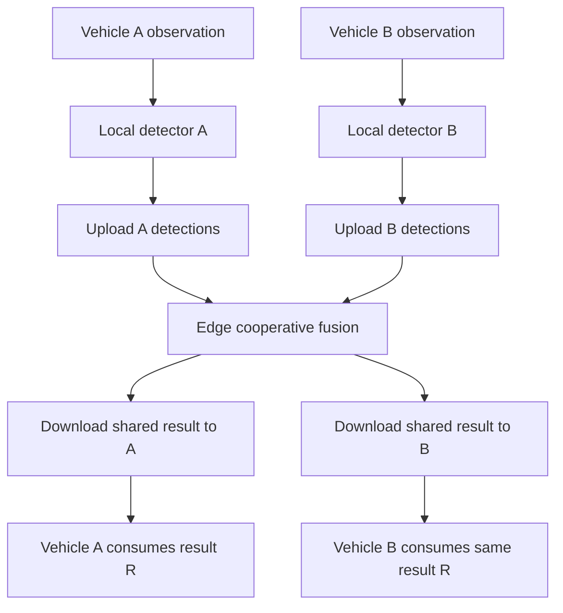

# P0: explicit execution plans and defensible resource accounting

**Status: implemented and tested in v0.4.** This is a simulation of compute,
network and inference *execution structure*. Recorded V2V4Real predictions are
never recomputed, and the resource profile values in the included examples are
**illustrative assumptions**, not measurements from V2V4Real hardware.

## Why this change exists

The v0.3 `always_share` policy turned a recorded cooperative late-fusion
prediction into one generic edge job fed by *one* agent's upload. That was a
useful reliability counterfactual but **not a faithful cost model for late
fusion**. The new `cooperative_late_fusion` mode explicitly represents every
required upstream operation:



For N agents, the graph has N local detector stages, N upstream detection
messages, one edge fusion compute stage, N downstream result messages and N
explicit deliveries. Inference artifact R has parent-result IDs corresponding
to **all N local detections**, and observation ancestry includes all agents.

**The graph models dependencies, not mathematical correctness of the fusion
model.** In trace mode the actual fusion answer comes from a named recorded
candidate. In synthetic mode, it comes from the configured edge error process.
The simulator deliberately does *not* generate a cooperative answer by OR-ing
local predictions or pretending to have run a vision model.

## Run the three-agent example without GPU

From the repository root:

```bash
python -m octopus_sim validate examples/three_agent_cooperative_fusion.json
python -m octopus_sim run examples/three_agent_cooperative_fusion.json \
  --output outputs/p0_three_agent
```

In the example, there are 50 events and three agents. It configures local
model output as 2,048 bytes, a fusion result as 128 bytes, 20 ms per local
model invocation and 8 ms per edge fusion. With zero packet loss and the
configured deadline, expected totals are:

| Metric | Expected |
|---|---:|
| Local model executions | 150 |
| Edge fusion executions | 50 |
| Local worker busy time (sum over devices) | 3,000 ms |
| Edge worker busy time | 400 ms |
| Upload detection bytes | 307,200 |
| Downlink result bytes | 19,200 |
| Total transmitted bytes | 326,400 |

These are deterministic cost-accounting totals **for the example's configured
profile**, not real device measurements. Model error rates remain stochastic.

Inspect `inferences.jsonl` and `operations.jsonl` to see the parent inference
IDs, actual stage completion order, and result delivery. `--no-events` skips
these two detailed execution/event ledgers (it still saves inference records,
plans, scores and all aggregate cost statistics).

## Reproduce the V2V4Real replay with full stage costs

```bash
python -m octopus_sim compare \
  examples/v2v4real_real_seq0007/scenario_p0_pipeline.json \
  --policies local_only,cooperative_late_fusion,mixed_local_fusion \
  --reuse-grid 0,0.25,0.5,0.75,1 \
  --no-events \
  --output outputs/p0_v2v4real
```

The example uses real source-verified recorded outcomes for 221 frames and
442 decision events, but **hypothetical device profiles**:

- Local detector `local_model`: 20 ms, 4,096-byte output
- Cooperative edge `late_fusion`: 6 ms, 128-byte output
- Shared network: 100 Mbps, 5 ms one-way latency, 4 channels
- Deadline: 400 ms, zero packet loss

These are experiment parameters; they do not assert actual hardware performance.

| Policy | Joint-error events | Local runs | Edge fusion runs | Bytes transmitted |
|---|---:|---:|---:|---:|
| `local_only` | 4 / 442 | 442 | 0 | 0 |
| `cooperative_late_fusion` | 16 / 442 | 442 | 221 | 1,867,008 |
| `mixed_local_fusion`, 50% nominal | 6 / 442 | 442 | 107 | 903,936 |

These are **v0.6 corrected frame-level** counts; the v0.5.1 per-ROI figures are archived under `samples/legacy_v051/`.

The source is **V2V4Real-derived**, and the decision labels are custom binary
regions, not official AP/mAP. Selection of fusion once per frame is a replay
counterfactual, not a historical coordination action. The result is **not a
resource efficiency improvement**: fusion incurs more compute and communication
than local-only in these settings. The improvement in marginal accuracy in
the previously published diagnostic does not imply a cheaper pipeline.

## Declarative model profiles and bindings

There is one model profile per deployed model variant (whether its code exists
inside OCTOPUS-Sim or its predictions come from a trace). Model profiles are
configured independently of the policy and graph scheduler:

```json
{
  "resources": {
    "model_bindings": {
      "local": "mobile_detector_small",
      "edge": "edge_detector_large",
      "fusion": "cooperative_fuser"
    },
    "model_profiles": {
      "mobile_detector_small": {
        "device": "local", "compute_ms": 20, "output_bytes": 4096
      },
      "edge_detector_large": {
        "device": "edge", "compute_ms": 30, "output_bytes": 128
      },
      "cooperative_fuser": {
        "device": "edge", "compute_ms": 6, "output_bytes": 128
      }
    }
  }
}
```

Required fields are exactly `device`, `compute_ms`, `output_bytes`. Invalid
model profiles (unknown key, wrong device, negative/non-finite duration, or
negative bytes) fail configuration validation. The `fusion` and `local`
profiles must be explicit for cooperative fusion; there is deliberately **no
silent default fusion cost**. Existing v0.3 scenarios without profiles retain
their previous `local_inference_ms`, `edge_inference_ms`, `observation_bytes`
and `result_bytes` defaults and behavior.

For trace replay of cooperative fusion, you **must** also identify which
recorded candidate is the true cooperative prediction, e.g.:

```json
"world": {
  "backend": "trace",
  "trace_file": "trace.jsonl",
  "fusion_candidate_key": "edge:ego"
}
```

The example `edge:ego` is the previously verified V2V4Real converter's name
for its late-fusion candidate. A new converter should preferably export an
explicit key such as `cooperative:late_fusion`. Missing trace candidates cause
strict validation failure; the simulator never fabricates one. This field is
*prediction lookup*, not an assertion that the fused result used only ego
observations; the fusion graph retains all parent observations.

## Software architecture and contracts

- `policies.py` chooses `Plan`, without ground truth or resource scheduling.
- `execution.py` compiles the plan into immutable `ExecutionGraph` and `Stage`
  objects, validates referential integrity, acyclicity, and exactly one
  delivery per participating agent.
- `execution_runtime.py` schedules those stages against the existing
  `EventLoop` and `FIFOResource`; it propagates packet failure to all
  dependent stages and preserves one inference result identity on fan-out.
- `world.py` resolves synthetic potential outcomes or strict recorded
  prediction keys, **without** computing neural predictions.
- `simulator.py` owns only the scenario lifecycle, outcome scoring and
  aggregate resource counters.

This is a deliberately small *modular monolith*: no distributed queue,
network microservice, or dependency on a physical-world simulator. The
independent graph schema is the intended boundary for future policy-driven
DAGs, time federation and external model/compute adapters.

### Stage structure and validation

Each immutable operation is `compute`, `transfer`, or `deliver`. It has a
stable per-event stage ID and direct dependency references. A compute operation
has a model, device, observation ancestry, backend candidate and optional
parent compute stages. A transfer has sender, recipient, payload size and
traffic role. A delivery identifies the **existing** compute result consumed
by an agent. Policy outputs are validated before execution.

For multi-source fusion, the parent results are local inferences. Uploads must
complete before fusion starts. If any upload is lost, fusion and its deliveries
are marked `dependency_failed`; the pre-upload local compute still consumes
resources. Deadlines do not cancel work; late deliveries are logged but are
not retroactively credited to the agent's decision.

### Metric semantics

| Metric | Meaning |
|---|---|
| `compute_executions_by_model` | Number of **started** compute stages, by model |
| `compute_busy_ms_by_model` | Sum of configured service times over started stages |
| `edge_cpu_busy_ms`, `local_cpu_busy_ms` | Sum of worker-busy times, **not elapsed makespan** |
| `transmitted_bytes_by_role` | Attempted uplink `observation`/`detection` and downlink `result` traffic |
| `transmitted_bytes` | Sum of message payload bytes attempted, including dropped messages |
| `link_busy_ms` | Sum of serialized transfer service times, not propagation |
| `edge_queue_wait_ms`, `local_queue_wait_ms` | Aggregate waiting time before compute starts |
| `agent_deadline_miss_rate` | Fraction missing an on-time result; separate from being incorrect |
| `joint_all_error_rate` | Fraction of decision events all agents are **incorrect on time** |

No metric above is a calibrated joule, watt-hour, packet-level radio trace or
measured device runtime. Total local busy time and total edge busy time are
separate heterogeneous resources and should **not** be collapsed into one
nominal energy or equivalent-cost score without a conversion model.

## Performance, failure modes and extension roadmap

P0 does **not** implement runtime resource-aware policy selection; the graph
can accurately account for a policy chosen ahead of time. P1 should expose
restricted queue/capacity snapshots and candidate execution-plan cost
estimates to coordinator policies, so they can compare cost against estimated
risk under budgets and deadlines without seeing future events or truth.

To support alternative processing chains (feature fusion, raw sensor upload,
selective verification) next, implement a *new compiler/graph builder* rather
than modifying the scheduler. Profile names and payload sizes remain data,
not hard-coded execution timings. Extend candidate-backend APIs in their own
module if more prediction types are required.

Before publishing calibrated resource claims, measure per-model runtime on
specified device hardware and serialized payload sizes for the selected
models. Confirm actual communication pattern, compression and batching. The
P0 profiles are placeholders until such validation is provided.

## Testing and reproducibility

```bash
python -m pytest -q
python -m compileall -q octopus_sim
```

The P0 test module covers 2/3/5 agents, exact compute/communication totals,
provenance and one shared result identity, dependency ordering, queueing,
loss propagation, deadline handling, mixed-policy endpoints, reproducibility,
custom model-role bindings, malformed graphs and profile validation, and
source-verified V2V4Real replay. Older baseline tests remain part of the suite.

The actual paper figures cannot be inferred from the model cost figures
without describing and justifying the model profiles. All release plots that
include costs must say **modeled** until calibrated with a specified device.
